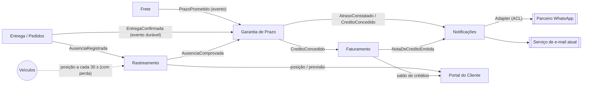

# 1. Modelagem do domínio

## Bounded contexts

| Contexto | Responsabilidade | Requisitos sob sua responsabilidade |
|---|---|---|
| **Garantia de Prazo** (novo) | Abre uma garantia para cada pedido, mede o atraso entre o Prazo Prometido e a Confirmação de Entrega, aplica a Política de Compensação do tipo de cliente e concede o crédito uma única vez | RF01, RF02, RF03, RF04, RF09, RNF02 |
| **Rastreamento** (telemetria da frota) | Recebe as posições dos veículos e avalia se uma ausência registrada está comprovada: veículo parado a até 200 m do endereço por pelo menos 10 min antes do registro | RF05, RNF01 (telemetria tolera perda) |
| **Entrega** (Pedidos, Java) | Registra a Confirmação de Entrega e o Registro de Ausência feitos pelo entregador e os publica sem perda | RNF01 (confirmação não tolera perda) |
| **Frete** (Python) | Calcula o valor do frete e define o Prazo Prometido no momento da contratação | Fonte de dados de RF01 (não é dono de RF novo) |
| **Faturamento** (C#) | Emite a Nota de Crédito com número sequencial e único, e mantém o saldo de créditos do cliente | RF06, RNF03 |
| **Notificações** (Node/TS) | Envia o aviso pelo Canal Preferido do cliente (e-mail ou WhatsApp), faz até 3 retentativas e encaminha a falha final para tratamento | RF07, RF08 |
| **Portal do Cliente** (React + BFF) | Mostra ao cliente a posição do veículo, a previsão de chegada e o saldo de créditos, com atualização ao vivo | RF10 |

> **Decisão:** o RF05 fica no Rastreamento, não na Garantia. Distância, tempo parado e
> posição GPS são linguagem da telemetria. A Garantia só recebe o fato `AusenciaComprovada`
> e isenta a garantia, sem conhecer coordenadas.
>
> **RNF04** (contêineres e subida com um comando) é transversal e fica na infraestrutura
> (`docker-compose.yml`), não em um contexto de negócio.

## Mapa de contexto

| Relação | Tipo | Observação |
|---|---|---|
| Frete → Garantia | Upstream / Downstream (Conformist) | A Garantia aceita o Prazo Prometido como o Frete o define |
| Entrega → Garantia | Upstream / Downstream (Published Language) | A `EntregaConfirmada` é um evento publicado com contrato estável |
| Rastreamento → Garantia | Upstream / Downstream | O Rastreamento entrega só o veredito (`AusenciaComprovada`), sem os dados brutos |
| Garantia → Faturamento | Customer / Supplier | O Faturamento emite a nota a partir do crédito concedido |
| Notificações → Parceiro WhatsApp | Anticorruption Layer | A API do parceiro tem formato diferente e é traduzida por um Adapter |
| Portal ← Rastreamento / Faturamento | Read model (BFF) | O Portal só lê, sem regra de negócio |

## Entidades e agregados

| Agregado | Raiz | Entidades e objetos de valor | Regra que protege |
|---|---|---|---|
| **Garantia** (Garantia de Prazo) | `Garantia` (uma por pedido) | VO `PedidoId`, VO `PrazoPrometido`, VO `TipoCliente`, VO `ValorFrete` (Dinheiro), VO `Atraso` (minutos), VO `Credito`; entidade `ConfirmacaoEntrega`; status `Ativa → Cumprida \| Violada \| Isenta` | Uma garantia concede **no máximo um** crédito (RF09); o crédito nunca passa do teto do tipo de cliente (RF02/RF03); uma garantia `Isenta` por ausência comprovada não gera crédito (RF05) |
| **AvaliacaoAusencia** (Rastreamento) | `AvaliacaoAusencia` | VO `Posicao` (lat/long), VO `Geocerca` (endereço + raio de 200 m), VO `JanelaParada` (≥ 10 min antes do registro) | Ausência só é comprovada se as posições mostrarem o veículo parado dentro da geocerca durante a janela inteira (RF05) |
| **NotaDeCredito** (Faturamento) | `NotaDeCredito` | VO `NumeroNota` (sequencial), VO `Valor`, VO `CreditoId` (origem) | Número sequencial e nunca repetido, inclusive sob concorrência (RF06/RNF03); uma nota por `CreditoId` |
| **Notificacao** (Notificações) | `Notificacao` | VO `CanalPreferido` (EMAIL \| WHATSAPP), entidade `TentativaEnvio`, status `Pendente → Enviada \| FalhaDefinitiva` | No máximo 1 envio + 3 retentativas; a falha definitiva sempre é registrada e encaminhada, nunca descartada (RF08) |

> **Serviço de domínio `PoliticaCompensacao`** (Garantia de Prazo): não é um agregado, porque
> não tem estado que mude nem ciclo de vida. É uma regra fixa, uma por tipo de cliente,
> formada pelos VOs `FaixaAtraso` (limite em minutos → percentual), `Multiplicador` e `Teto`.
> O agregado `Garantia` a usa para calcular o crédito. Um tipo de cliente novo é uma política
> nova, sem alterar as existentes (RF04).

## Linguagem ubíqua

| Termo | Definição |
|---|---|
| **Garantia de Prazo** | Compromisso de compensar o cliente com crédito quando a entrega de um pedido atrasar |
| **Prazo Prometido** | Data e hora limite de entrega definidas pelo serviço de Frete na contratação |
| **Confirmação de Entrega** | Registro, feito pelo entregador, de que o pedido foi entregue, com data e hora. Fonte oficial do fim da entrega |
| **Atraso** | Diferença entre a Confirmação de Entrega e o Prazo Prometido, em minutos e exibida em horas. Atraso ≤ 0 significa entrega no prazo (RF01) |
| **Faixa de Atraso** | Intervalo de atraso associado a um percentual do frete: até 2 h → 0%; acima de 2 h até 24 h → 10%; acima de 24 h até 72 h → 25%; acima de 72 h → 50% (RF02) |
| **Tipo de Cliente** | Classificação comercial que define a Política de Compensação: Varejo, Corporativo ou Cortesia |
| **Política de Compensação** | Regra que transforma atraso e frete em valor de crédito para um Tipo de Cliente |
| **Multiplicador** | Fator aplicado aos percentuais da faixa: 1× para Varejo, 2× para Corporativo (RF03) |
| **Teto** | Valor máximo de crédito por pedido: R$ 500 (Varejo) e R$ 2.000 (Corporativo) |
| **Crédito** | Valor concedido ao cliente pelo atraso, já limitado pelo teto. Gerado no máximo uma vez por pedido |
| **Cliente Cortesia** | Tipo de cliente cujo frete é zero. Não recebe crédito, mas é notificado do atraso (RF03) |
| **Registro de Ausência** | Apontamento do entregador de que o destinatário não estava no endereço |
| **Ausência Comprovada** | Registro de Ausência confirmado pela telemetria: veículo parado a até 200 m do endereço por pelo menos 10 min antes do registro. Isenta a garantia (RF05) |
| **Garantia Isenta** | Garantia encerrada sem crédito por causa de uma Ausência Comprovada |
| **Nota de Crédito** | Documento fiscal emitido pelo Faturamento para cada crédito, com Número de Nota sequencial e único (RF06) |
| **Saldo de Créditos** | Soma dos créditos disponíveis do cliente, exibida no Portal (RF10) |
| **Canal Preferido** | Meio escolhido pelo cliente para receber avisos: e-mail ou WhatsApp (RF07) |
| **Falha Definitiva** | Notificação que falhou no envio original e nas 3 retentativas. Vai para a fila de falhas e gera alerta (RF08) |
